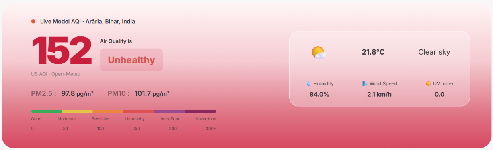

<div align="center">

# 🌿 BreatheWise

### Understand the air. Make more informed decisions.

An AI-powered air-quality companion that turns environmental data into clear, practical guidance.

[](https://www.python.org/)
[](https://streamlit.io/)
[](https://open-meteo.com/)
[](https://openrouter.ai/)

**[🌍 Launch BreatheWise](https://breathewise-devaamirreza.streamlit.app/)** · **[📦 Source Code](https://github.com/devaamirreza/breathewise)**

</div>

---

## ✨ What is BreatheWise?

Air-quality numbers are useful, but they can be difficult to interpret in everyday life. BreatheWise brings air-quality and weather information together in one calm, approachable interface, with an AI assistant that can explain readings, answer questions, and look up conditions for other cities.

Search for a city, understand its current conditions, and ask BreatheWise what the information may mean for your day.

## 📸 Application Preview

<p align="center">
  
</p>

## 🌬️ Features

- **City-based air-quality lookup** — search for a location and retrieve its available air-quality information.
- **AQI at a glance** — view the US AQI value, category, and key pollutant readings.
- **Weather context** — see current temperature, humidity, and wind conditions alongside air quality.
- **AI companion** — ask questions in natural language and request information about other cities.
- **Multi-city reasoning** — the assistant can retrieve conditions for multiple cities and compare the returned results.
- **Practical guidance** — receive clear, general exposure suggestions based on the available conditions.

## 🧠 How it works

```text
                    ┌──────────────────────┐
                    │      User input      │
                    │       City / Chat    │
                    └──────────┬───────────┘
                               │
                 ┌─────────────┴─────────────┐
                 │                           │
                 ▼                           ▼
       ┌──────────────────┐        ┌──────────────────┐
       │  Streamlit app   │        │  AI agent        │
       │  Dashboard       │        │  OpenRouter      │
       └────────┬─────────┘        └────────┬─────────┘
                │                           │ tool call
                └─────────────┬─────────────┘
                              ▼
                   ┌────────────────────┐
                   │ Open-Meteo APIs    │
                   │ Geocoding, air,    │
                   │ and weather        │
                   └─────────┬──────────┘
                             ▼
                   ┌────────────────────┐
                   │ Results and clear  │
                   │ user-facing answer │
                   └────────────────────┘
```

The AI assistant uses a generic city-conditions tool. It decides when a lookup is useful and can call the same tool for more than one city when a question requires it.

## 🛠️ Technology

| Layer | Technology |
|---|---|
| User interface | Streamlit |
| Language | Python |
| Air-quality data | Open-Meteo Air Quality API |
| Location search | Open-Meteo Geocoding API |
| Weather data | Open-Meteo Forecast API |
| AI model access | OpenRouter |
| HTTP requests | Requests |
| Local configuration | python-dotenv |
| Hosting | Streamlit Community Cloud |

## 📊 Data notes

- The dashboard displays **US AQI**. It should not be interpreted as India's CPCB AQI.
- Open-Meteo air-quality values are **model-based estimates**, not direct readings from a nearby regulatory monitoring station.
- Values and timestamps depend on the data returned by the upstream service.
- BreatheWise is an informational companion, not a medical device. Its suggestions do not replace professional medical advice.

## 🚀 Run locally

### 1. Clone the repository

```bash
git clone https://github.com/devaamirreza/breathewise.git
cd breathewise
```

### 2. Create and activate a virtual environment

**Windows (Command Prompt):**

```cmd
python -m venv venv
venv\Scripts\activate
```

**macOS / Linux:**

```bash
python3 -m venv venv
source venv/bin/activate
```

### 3. Install dependencies

```bash
pip install -r requirements.txt
```

### 4. Configure your OpenRouter key

Create a `.env` file in the project root:

```env
OPENROUTER_API_KEY=your_openrouter_api_key
```

Keep this file private. It is excluded from Git by `.gitignore`.

### 5. Start the app

```bash
streamlit run app.py
```

## ☁️ Deploy on Streamlit Community Cloud

1. Sign in to [Streamlit Community Cloud](https://share.streamlit.io/).
2. Create an app from this repository.
3. Select the `main` branch and `app.py` as the entry point.
4. Add the following under **App settings → Secrets**:

```toml
OPENROUTER_API_KEY = "your_openrouter_api_key"
```

5. Deploy the app.

Do not commit `.env` or paste API keys into source files, screenshots, issues, or pull requests.

## 📁 Project structure

```text
breathewise/
├── agent/
│   ├── __init__.py
│   ├── prompts.py
│   ├── runner.py
│   └── tools.py
├── .env.example
├── .gitignore
├── app.py
├── breathewise_agent_instructions.md
└── requirements.txt
```

## 🗺️ Roadmap

Ideas for future iterations:

- [ ] Add clearer data freshness and location-resolution details.
- [ ] Improve error and empty-state messaging for unavailable city data.
- [ ] Add automated tests for API responses and agent tool-calling.
- [ ] Add multilingual assistant responses.
- [ ] Improve accessibility and mobile interaction.
- [ ] Add a transparent explanation of how recommendations are formed.

## 🤝 Contributing

Ideas, bug reports, and thoughtful improvements are welcome.

1. Fork the repository.
2. Create a feature branch.
3. Make your changes and test locally.
4. Open a pull request describing the change.

Please do not include API keys, personal information, or private configuration in contributions.

## ⚠️ Disclaimer

BreatheWise provides general environmental information and educational guidance. Air-quality data may be estimated, delayed, incomplete, or unavailable. It is not a substitute for official local advisories, medical advice, diagnosis, or treatment. For urgent health concerns, contact a qualified healthcare professional or local emergency services.

## 📄 License

No license has been added yet. Until a license is included in this repository, all rights remain with the copyright holder; do not assume the code is available for reuse or redistribution.

---

<div align="center">

Made with 🌿 and curiosity.

**BreatheWise — make every breath a more informed one.**

</div>
